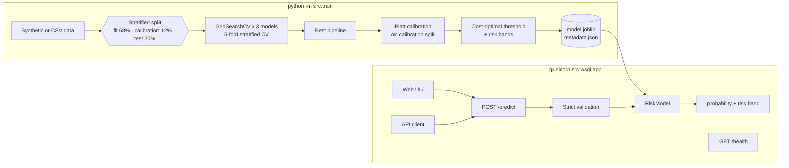

# Loan Default Risk Scoring API

End-to-end credit-risk system: a calibrated default-probability model, a cost-based approval
policy, and a validated REST API with a web UI, packaged with Docker.

`Python 3.13` · `scikit-learn 1.9` · `pandas` · `Flask` · `gunicorn` · `Docker` · `pytest`

> **Data disclaimer.** No real lending data is included. Training uses a documented synthetic
> portfolio (`src/data.py`, ~13% default rate, injected missingness). All metrics below describe
> that data, not real-world performance. The pipeline accepts real data unchanged:
> `python -m src.train --data loans.csv`.

---

## 1. Overview

**Problem.** Given an applicant's income, credit history and loan terms, estimate the probability
of default and turn it into an approve / review / decline signal that reflects the asymmetric cost
of lending mistakes.

**What this repo delivers**

| Layer | What it does |
|---|---|
| Modelling | Compares Logistic Regression, Random Forest and Gradient Boosting with stratified CV and grid search; handles class imbalance; calibrates probabilities |
| Decision policy | Chooses the approval threshold by minimising expected cost, not by maximising accuracy |
| Serving | Flask API (`/predict`, `/health`) with strict input validation, JSON errors, gunicorn, Docker |
| Interface | Dependency-free web UI at `/` for interactive scoring |
| Quality | 68 automated tests, including a serving/training parity check and an end-to-end training run |

## 2. Results

Held-out test set: 3,000 applicants, 13.2% defaults. Model: Logistic Regression (selected by CV
ROC-AUC), Platt-calibrated.

**Model selection** (5-fold stratified CV on the 10,200-row fit split)

| Model | ROC-AUC (mean ± sd) | Recall, default class | PR-AUC | Best hyper-parameters |
|---|---|---|---|---|
| **Logistic Regression** | **0.767 ± 0.017** | 0.687 | 0.378 | `C=0.01` |
| Gradient Boosting | 0.759 ± 0.015 | 0.680 | 0.356 | `lr=0.05, max_depth=2, n_estimators=150` |
| Random Forest | 0.758 ± 0.017 | 0.583 | 0.359 | `max_depth=10, min_samples_leaf=30, n_estimators=400` |

The three models are within one standard deviation of each other. Logistic Regression wins here
because the synthetic data is generated by a logistic process, so a linear model is the correct
model class. On real data with non-linearities and interactions, boosted trees would be expected
to lead; the pipeline selects automatically.

**Test performance and business impact**

| Metric | Value |
|---|---|
| ROC-AUC / PR-AUC | 0.773 / 0.370 |
| Brier score (uncalibrated → calibrated) | 0.193 → 0.099 |
| Mean predicted probability vs. observed default rate | 13.7% vs. 13.2% |
| Decision threshold (cost-optimal) | 0.20 |
| Recall on default class / precision | 0.539 / 0.336 |
| Approval rate | 78.9% |
| Default rate inside the approved book | 7.7% (vs. 13.2% unfiltered) |
| Expected cost per applicant | 0.443 vs. 0.658 for approve-everyone (**-33%**) |

**Risk bands are monotonic and well separated** (test set):

| Band | Rule | Applicants | Observed default rate |
|---|---|---|---|
| Low | p < 0.10 | 1,589 | 4.7% |
| Medium | 0.10 ≤ p < 0.20 | 778 | 13.8% |
| High | p ≥ 0.20 | 633 | 33.6% |

Plots: [`reports/threshold_analysis.png`](reports/threshold_analysis.png) (recall, precision and
approval rate vs. threshold, plus the cost curve) and [`reports/roc_curve.png`](reports/roc_curve.png).
Full tables are in `reports/*.csv`.

## 3. Architecture



### Modelling pipeline

A single `sklearn.pipeline.Pipeline` is the unit that gets trained, calibrated, pickled and served:

```
raw record → feature engineering (loan_to_income)
           → numeric: median impute (+ missing indicators) → StandardScaler
           → categorical: most-frequent impute → OneHotEncoder(handle_unknown="ignore")
           → classifier
```

Because preprocessing is part of the persisted object, the API cannot drift from training-time
preprocessing. `tests/test_pipeline.py::test_serving_matches_training_pipeline` enforces this.

### Key methodology decisions

- **Three-way split, no leakage.** Test (20%) is touched once. Of the remainder, 15% is a
  calibration split used for Platt scaling and for choosing the decision threshold. Model selection
  uses only the fit split.
- **Class imbalance (~13% positives).** `class_weight="balanced"` (LR), `"balanced_subsample"` (RF),
  and balanced `sample_weight` for `GradientBoostingClassifier`, which has no `class_weight` argument.
- **Calibration.** Class weighting inflates scores for the rare class. Platt scaling on held-out data
  restores real default frequencies, which matters because the API returns a *probability* and the
  threshold is a cost trade-off. Brier score halves (0.193 → 0.099).
- **Cost-based threshold.** Decline if `P(default) ≥ t`. Approving a defaulter is assumed to cost 5×
  the profit lost by declining a good applicant (`src/config.py`; replace with real unit economics).
  The grid search minimises expected cost per applicant; the theoretical optimum `1/(1+5) ≈ 0.17`
  agrees closely with the empirical 0.20.
- **Missing data is a first-class case.** Optional fields can be omitted at inference; imputers (with
  missing-indicator flags) handle them identically to training. Unseen categories are ignored rather
  than raising.

## 4. API

Base URL: `http://localhost:8000`

### `GET /health`
```json
{"status": "ok", "model_loaded": true, "model_version": "1.0.0"}
```
`503` with `{"status": "unavailable"}` if the artifact failed to load (suitable for liveness/readiness probes).

### `POST /predict`
```bash
curl -X POST localhost:8000/predict -H "Content-Type: application/json" -d '{
  "age": 38, "annual_income": 62000, "home_ownership": "MORTGAGE",
  "loan_amount": 12000, "loan_term_months": 36, "loan_purpose": "debt_consolidation",
  "interest_rate": 11.5, "credit_score": 690
}'
```
```json
{"default_probability": 0.0841, "risk_category": "low", "model_version": "1.0.0"}
```

**Input schema**

| Field | Type | Required | Constraint |
|---|---|---|---|
| `age` | int | yes | 18–100 |
| `annual_income` | number | yes | 1–10,000,000 |
| `loan_amount` | number | yes | 500–100,000 |
| `loan_term_months` | int | yes | 12–60 |
| `interest_rate` | number (%) | yes | 0–40 |
| `home_ownership` | string | yes | `RENT` `MORTGAGE` `OWN` `OTHER` (case-insensitive) |
| `loan_purpose` | string | yes | `debt_consolidation` `credit_card` `home_improvement` `car` `small_business` `medical` `other` |
| `employment_years` | number | no | 0–60, consistent with `age` |
| `credit_history_years` | number | no | 0–80, consistent with `age` |
| `credit_score` | int | no | 300–850 |
| `num_credit_lines` | int | no | 0–60 |
| `delinquencies_2y` | int | no | 0–50 |
| `credit_utilization` | number (%) | no | 0–150 |
| `debt_to_income` | number (%) | no | 0–100 |

Optional fields may be omitted or `null`.

**Validation is strict by design:** unknown fields are rejected (typos never silently become "missing"),
booleans and numeric strings are not accepted as numbers, `NaN`/`Infinity` are rejected, and
cross-field rules (e.g. employment years vs. age) are enforced. All errors for a request are returned together.

| Status | Meaning |
|---|---|
| `200` | Scored |
| `400` | Malformed JSON or wrong `Content-Type` |
| `413` | Body larger than 64 KB |
| `422` | Validation failure, with per-field `details` |
| `503` | Model artifact unavailable |

```json
{"error": "validation_failed", "details": [{"field": "age", "message": "must be >= 18"}]}
```

Applicant fields are never written to logs; only the resulting band and probability are.

## 5. Web UI

`http://localhost:8000/` serves a single self-contained HTML page (no build step, no external
dependencies, light/dark aware). It offers example profiles, calls `/predict`, renders a probability
meter and colour-coded risk badge, and maps server-side validation errors onto the matching form fields.

## 6. Quick start

Requires Python 3.11+ (pinned `pandas 3.x`).

```bash
git clone https://github.com/<your-username>/loan-default-api.git && cd loan-default-api
python -m venv .venv
source .venv/bin/activate          # Windows PowerShell: .venv\Scripts\Activate.ps1
pip install -r requirements-dev.txt

python -m pytest                   # 68 tests
flask --app src.wsgi run --port 8000
```

A trained artifact is committed in `models/`. To retrain:

```bash
python -m src.train                # full grids, 5-fold CV (~3 min on 2 cores)
python -m src.train --quick        # tiny grids (~10 s)
python -m src.train --data my.csv  # real data: same columns + binary `default`
python -m src.train --models logistic_regression gradient_boosting --cv-folds 10
```

Training writes `models/model.joblib`, `models/metadata.json` (selected model, best params, CV and test
metrics, thresholds, library versions) and `reports/`.

### Docker

```bash
docker build -t loan-default-api .
docker run --rm -p 8000:8000 loan-default-api
```
The image runs gunicorn as a non-root user, exposes `/health` as a `HEALTHCHECK`, and reads
`MODEL_PATH`, `METADATA_PATH` and `PORT` from the environment.

## 7. Project structure

```
src/
  config.py          Feature lists, paths, cost assumptions (single source of truth)
  data.py            Synthetic portfolio generator
  features.py        Feature engineering that runs inside the Pipeline
  pipeline.py        Pipelines and hyper-parameter grids
  train.py           CV comparison, tuning, calibration, threshold analysis, artifact export
  schemas.py         Strict request validation
  model_service.py   Artifact loading, scoring, risk banding
  app.py             Flask application factory (/, /health, /predict)
  wsgi.py            gunicorn entry point
  static/index.html  Web UI
tests/               68 tests
models/              model.joblib, metadata.json
reports/             Model comparison, CV grid, threshold analysis (CSV + PNG)
Dockerfile · Makefile · requirements*.txt
```

## 8. Testing

`python -m pytest` runs 68 tests (~3 s):

- **Validation:** types, ranges, categories, normalisation, unknown fields, cross-field rules, multi-error reporting
- **API:** every status code, determinism, optional-field handling, JSON error bodies, oversized payloads, missing model
- **Behaviour:** a high-risk applicant scores above a low-risk one and lands in the right band
- **Pipeline:** all three models fit with missing values; unseen categories and all-missing rows don't crash
- **Parity:** the API path returns the same probability as calling the pipeline directly
- **Decision analysis:** threshold-table monotonicity and "beats approve-everyone"
- **End to end:** a quick training run, then load and score from the saved artifact

## 9. Reproducibility

- Fixed seeds throughout (`RANDOM_STATE = 42`); the generator and all splits are deterministic.
- Dependencies are pinned in `requirements.txt`. `scikit-learn` is pinned exactly because a pickled
  model must be loaded by the version that trained it; the version is also recorded in `metadata.json`.

## 10. Limitations and responsible use

- **Synthetic data.** Absolute numbers do not transfer to production. Re-run the full evaluation on real data.
- **Cost ratio is an assumption.** The 0.20 threshold follows from a 5:1 cost ratio; calibrate it to real
  loss-given-default and margin.
- **Out-of-distribution inputs.** Extreme combinations of risk factors push probabilities toward 0 or 1.
  Production use needs input-range and drift monitoring.
- **No fairness or explainability layer.** Lending decisions are regulated (e.g. ECOA/FCRA, GDPR, RBI
  guidelines). Protected-attribute and proxy analysis, adverse-action reason codes and human review
  are required before any real use. This project is for demonstration and learning.
- **Single static model.** No online learning, champion/challenger setup or automated retraining.

## 11. Roadmap

- SHAP-based reason codes per prediction
- Drift and calibration monitoring; scheduled retraining
- Batch scoring endpoint
- API-key authentication and rate limiting
- CI (tests, lint, image build) and a model registry
- Fairness audit across segments